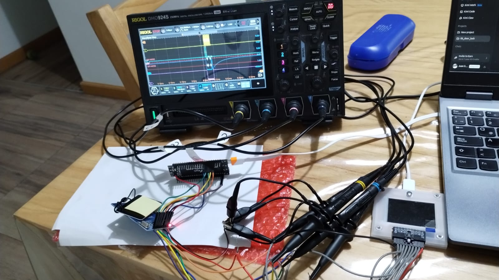
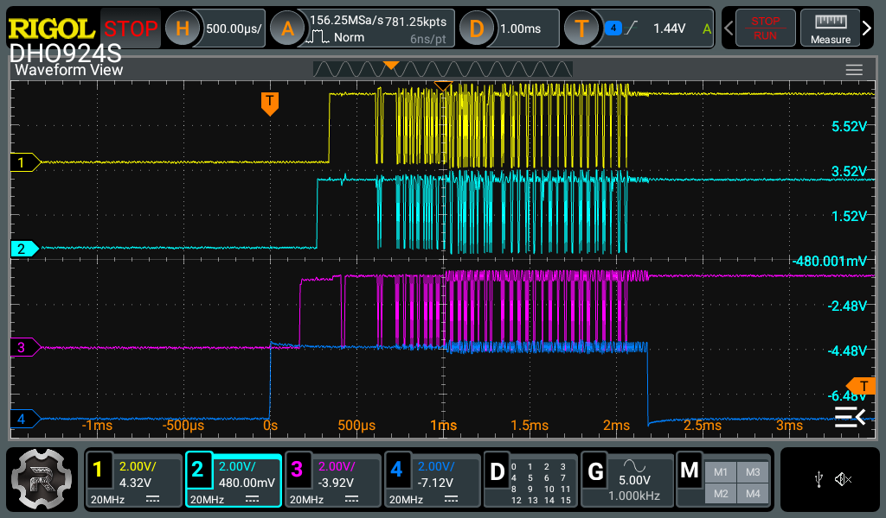
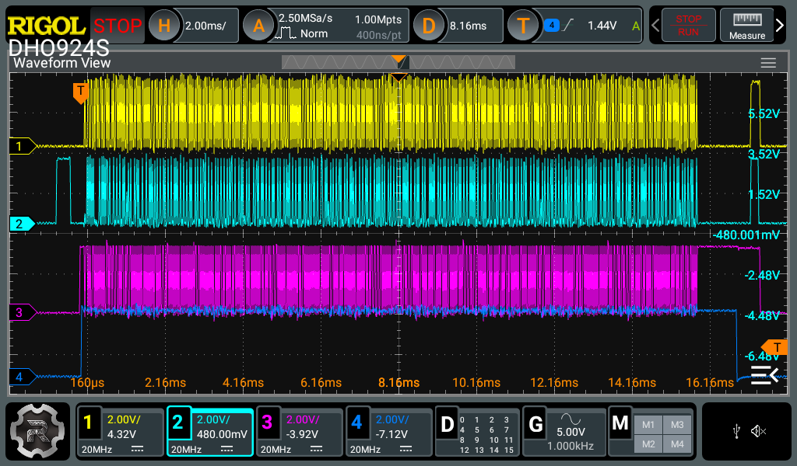
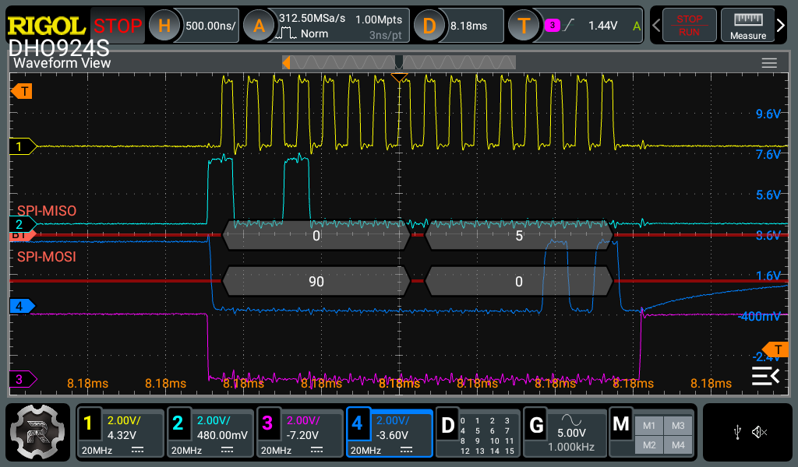

# mifare_test — Stage 2 console test harness

Console-driven bench tester for the `mifare` component (MFRC522-compatible
readers: **NZ3801-AB** on the ES242F lock, **RC522 modules** on the bench).
Same philosophy as Stage 1 (`fpm_test`): validate the isolated library against
real hardware with scope/sniffer evidence before any integration.

**Status: BENCH VALIDATED (2026-08-06).** Full ISO14443-3 + Mifare Classic
stack proven with 3 real cards, sniffer-verified byte-level parity with the
OEM firmware, including the 1 Hz `poll` cycle replica (5/5 card branches
byte-faithful). Pending: lock-board port + scope A/B of the idle burst.



*The lab: ESP32-S3 DevKitC-1 + RC522-clone module (VersionReg=0xB2, same
NZ3801-class silicon as the lock), 4-channel scope on CS/CLK/MOSI/MISO, and a
PIO-based SPI sniffer feeding a register-level decoder. The sniffer — not
hope — is what closed every bug in this stage.*

## Bench wiring (RC522 module → ESP32-S3 DevKitC-1)

| RC522 pin | ESP32-S3 GPIO | Notes |
|---|---|---|
| SDA (CS)   | GPIO10 | chip select |
| SCK        | GPIO12 | |
| MOSI       | GPIO11 | |
| MISO       | GPIO13 | |
| RST        | GPIO9  | NRSTPD — hard power-down/reset |
| IRQ        | —      | leave unconnected (OEM never uses it) |
| 3.3V / GND | 3V3 / GND | module is 3.3 V only |

Any free GPIOs work — pass yours to `init`. Avoid strapping pins (0, 3, 45, 46).

## Build & flash

```bash
idf.py set-target esp32s3
idf.py build flash monitor
```

### Bench antenna flag (RC522-clone modules only)

The OEM idle-burst antenna config (`TxControlReg=0x03`, TX1+TX2 without
InvTx2) does **not** excite the bench module's antenna — proven A/B
(`mifare_poll_fail.txt` vs `mifare_poll_works.txt`). This is a bench-module
antenna artifact, not a silicon difference. For bench bring-up of
`burst`/`poll`, build with:

```bash
idf.py -DCMAKE_C_FLAGS=-DMIFARE_BENCH_MODULE=1 build flash monitor
```

This sets `OEM_TX_CONTROL_BURST=0x83` (InvTx2RFOn). **For the lock-board
port, build without the flag** — OEM parity (0x03) is the default.

## Quick start

```
init -m 11 -s 13 -c 12 -C 10 -r 9 -V 0x91     # RC522 genuine; use -V 0xB2 on the lock board
version
select                                       # present a card: UID/SAK/ATQA
auth -b 4 -t a -k FFFFFFFFFFFF               # factory-default card
read -b 4
burst                                        # single OEM idle-burst replica (scope A/B)
poll -n 20 -p 1000                           # OEM 1 Hz cycle replica
```

Expected `poll` output with a card on the antenna (bench build):

```
I (25392) CMD: cycle 0: CARD DETECTED (ModemState=0x01) — full branch
I (25402) CMD: UID: C5099803 (4 bytes) | SAK: 0x08 | ATQA: 0x0004
I (25422) CMD: OEM probe auth: FAIL (vestigial — FAIL expected)
```

## Command reference

| Command | Purpose |
|---|---|
| `init -m -s -c -C -r [-q irq] [-f hz] [-V ver]` | SPI + driver + full OEM init + VersionReg self-test |
| `deinit` | Power down, park pins LOW, release driver |
| `power -s 0\|1` | NRSTPD up/down (+ full OEM init on up) |
| `version` | Read VersionReg |
| `wupa` / `reqa` | Single wake/request, prints ATQA |
| `select` | Anticollision + select (CL1–CL3), caches the card |
| `halt` | HLTA; then verify `reqa` misses and `wupa` finds the card |
| `auth -b blk -t a\|b -k <12hex>` | MFAuthent; verifies Crypto1On |
| `read -b blk` | Read 16-byte block (needs auth) |
| `write -b blk -d <32hex>` | Write block (block 0 and trailers refused) |
| `burst` | One OEM idle burst: config subset + WUPA + ModemState watch |
| `poll [-n count] [-p ms]` | OEM 1 Hz cycle replica incl. vestigial auth probe |
| `reg r\|w <addr> [val]` | Raw register access (clone tuning: RFCfgReg, 0x23/0x25…) |
| `dump` | All registers with names — diff against the OEM table |

## Acceptance tests (Stage 2)

1. `init` + `version` → `0x91`/`0x92` genuine RC522, `0xB2` clone. ✅
2. `wupa` with a card present → ATQA `0x0004` (Classic 1K) / `0x0044` (7-byte card). ✅
3. `select` → known UIDs: `C5099803`, `0483AC03` (Classic 1K), and the
   7-byte DESFire (`04670DFAA95D80`). ✅
4. `auth` (factory key) + `read`/`write` round-trip on a spare card. ✅
5. `poll -n 5` with card → 5/5 CARD DETECTED, card branch byte-faithful to
   OEM (sniffer A/B vs `card_c5099803_tuya_registrada.txt`). ✅ (bench build)
6. `burst` / `poll` → scope A/B against `oem_idle_burst_reference.png`.
   ⏳ Lock-board test (bench antenna differs — see flag above).
7. `power -s 0` → scope: NRSTPD LOW **and** SCK/MOSI/MISO/CS parked LOW.
8. `halt` → `reqa` reports no card, `wupa` finds it again.

## Scope evidence



*OEM reference: one 1 Hz idle burst on the lock board (~2.2 ms SPI window).
Yellow = CLK, cyan = MISO, violet = CS, blue = MOSI. This is the waveform
`burst` replicates for the lock-board A/B.*



*Bench: one `poll` cycle with card detected — full card branch (SoftReset +
full init + WUPA + anticoll + select + vestigial auth probe) spanning ~16 ms.
Sniffer decode of the same run: 3359 SPI frames, 5/5 cycles identical.*



*Zoom on a single register write (MOSI `90 00` = read FIFO level `0x0A`,
MISO returns `05`): the FIFOLevelReg polling loop that replaces the clone's
unusable IRQs.*

## Documented deviations from OEM

- **Cascade CL2/CL3:** the OEM ignores cascade levels (reports 7-byte cards as
  `88 xx yy zz` — e.g. the DESFire shows as "8804670D" on the lock). This
  driver resolves the full UID. Strict improvement; our credential cards are
  4-byte-UID Classic 1K anyway.
- **No vestigial auth in the card path by default:** the OEM probes every card
  with a fixed key (`04 01 07 00 05 09`), always fails and ignores the result.
  The `poll` command replicates the probe for waveform comparison only.
- **Wait strategy = FIFOLevelReg / CommandReg polling.** First bench run
  proved this is mandatory, not optional: on the NZ3801-class clone,
  ComIrqReg RxIRq asserted but the Transceive command never terminated, and
  the TAuto hardware timer never fired (TimerIRq stayed clear for a full
  50 ms window). The OEM sidesteps all of it — after WUPA/anticoll/select it
  polls FIFOLevelReg, after MFAuthent it polls CommandReg until Idle. We now
  do exactly the same, with a software deadline and an Idle abort on timeout.
- **Self-reception guard:** on long CRC-enabled frames the clone's receiver
  comes up during our own TX and the FIFO fills with our own tail bytes
  before the card could answer (SELECT: 6 bytes ~150 µs into a ~770 µs
  frame). Fix: one single FIFO flush timed at TX-end + 100 µs. Never flush
  mid-reception — it stalls the clone's receiver.

## Bench findings (RC522-clone module, VersionReg=0xB2)

- The bench module is the same silicon family as the lock (0xB2), so the
  bench is highly representative.
- Full stack validated with 3 real cards: WUPA/ATQA, anticollision CL1+CL2,
  SELECT/SAK, Crypto1 auth (Key A), block read, block write+verify, and the
  1 Hz `poll` cycle replica with card branch (5/5, sniffer-verified).
- Antenna artifact: bench module needs InvTx2RFOn during the idle burst to
  excite cards (`MIFARE_BENCH_MODULE=1`); the lock's antenna works with the
  OEM value 0x03. See *Bench antenna flag* above.
- Harness extras (NOT OEM behavior, bench tooling in `main/`): state-tolerant
  `select` (HLTA + WUPA + anticollision) because the bench RF field is not
  duty-cycled; `auth`/`read`/`write` commands for the sector-1 token scheme.

## Evidence base (see PROJECT_NOTES.md, Stage 2)

- Init/burst/transaction sequences: byte-level SPI sniffer captures of the OEM
  firmware (`NZ3801_*.txt`, `card_*.txt`) vs our runs (`mifare_lib_*.txt`,
  `mifare_poll_works.txt`), decoded with `rfid_decoder.py`.
- SPI clock 6 MHz, NRSTPD duty-cycling, two power modes (touch-gated vs
  continuous 1 Hz): scope captures.
- OEM security model proven UID-only; our scheme = sector auth + token
  (sector 1, derived keys, monotonic counter).
